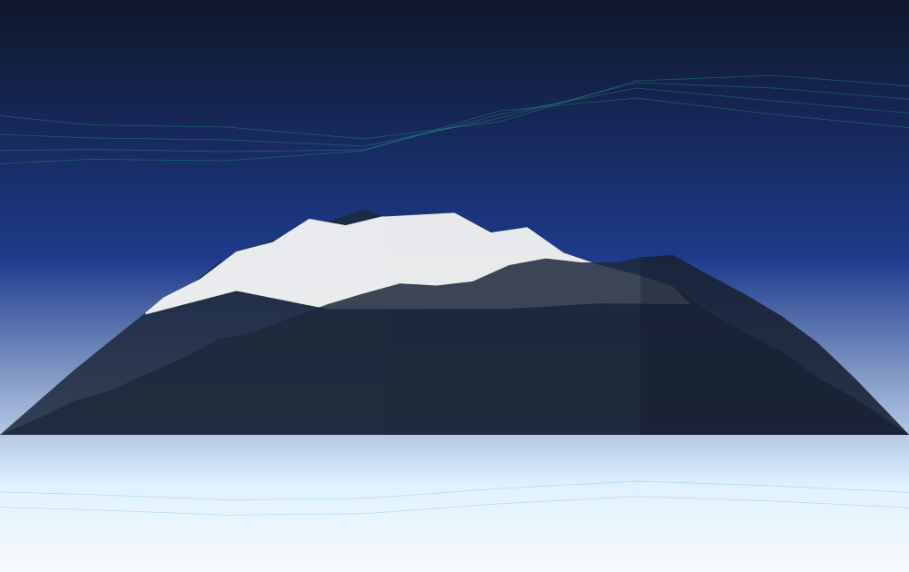
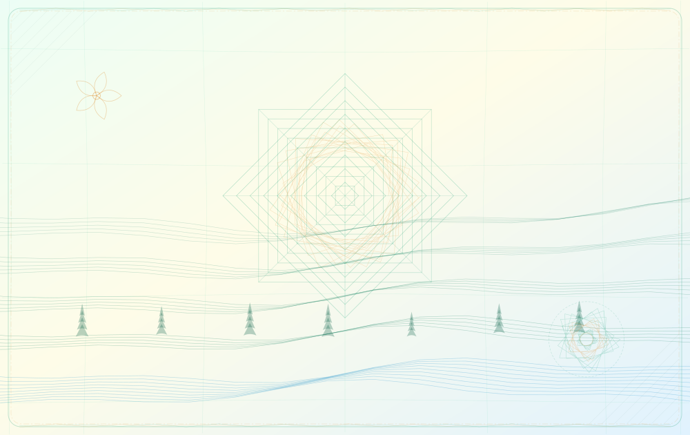
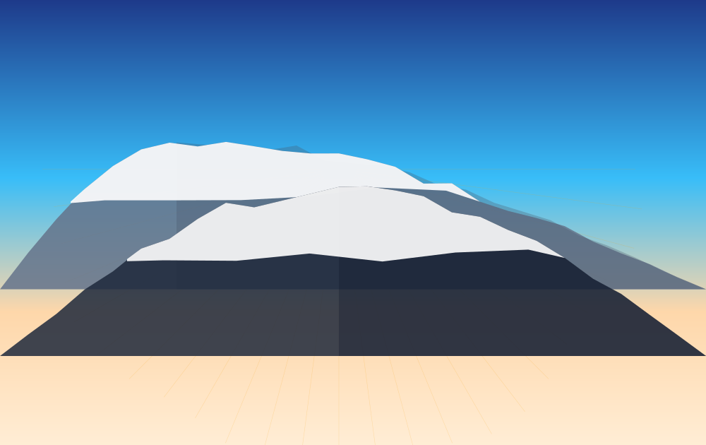
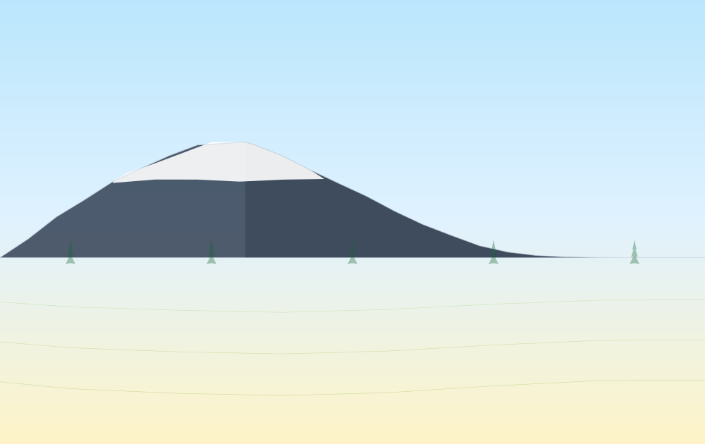
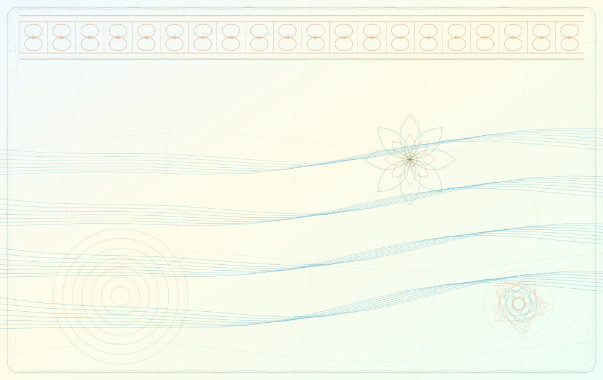
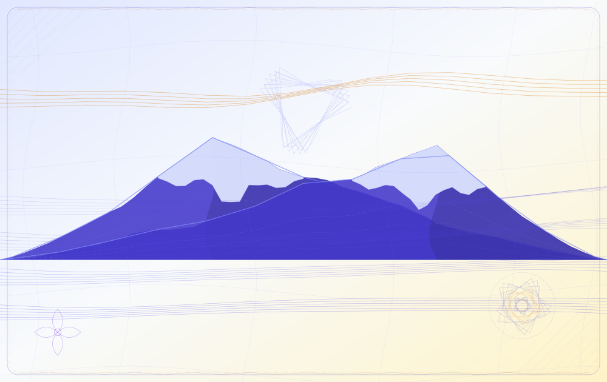
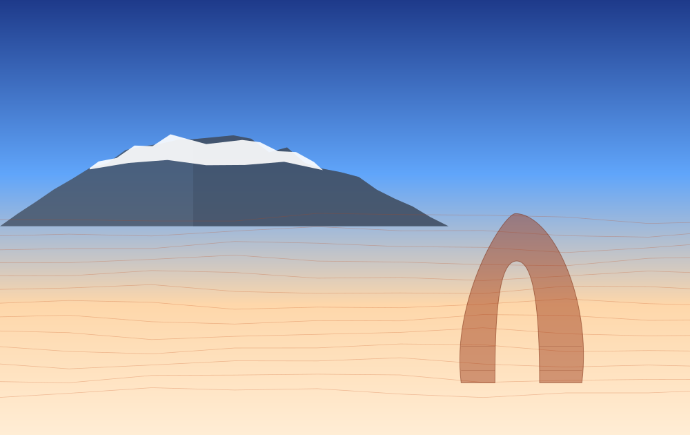
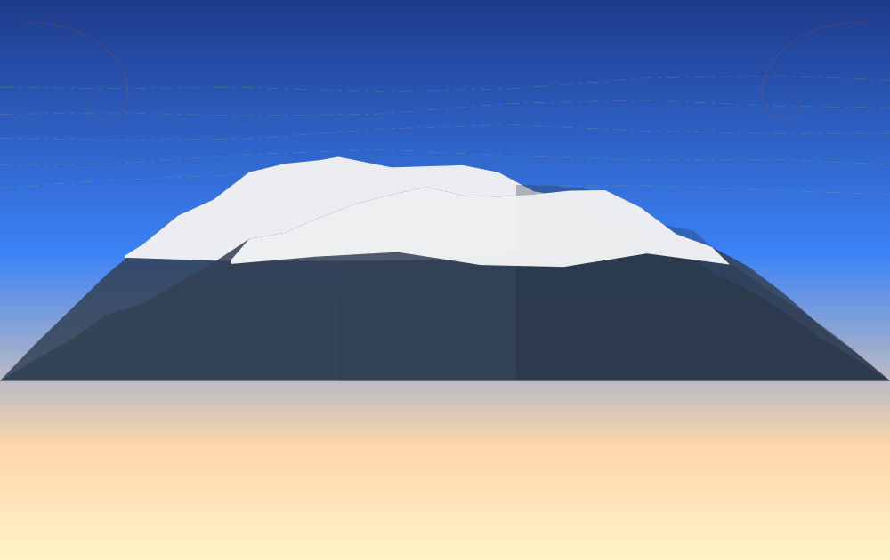

# Procedural ID Card Backgrounds

Procedural SVG and PNG background generator for synthetic identification-card datasets across 10 distinct US states. Generates 100% original algorithmic vector artwork inspired by visually inspected public state driver-license specimen images, featuring mathematically coupled mountain-snow-arête geometry, iconic landmarks (Mount Sneffels, Devils Tower, Delicate Arch, Springfield Capitol Rotunda, Mount Rainier, Denali), non-linear warped security grids, guilloche rosettes, OVI security medallions, and banknote border engraving.

---

## Render Samples (Pass 8 Production Renders)

Each preview below is rendered directly from the procedural vector code (Seed: 42, CR80 standard 1000x630 aspect ratio) and grounded in direct raster specimen images from official state DMV sources (documented in [`docs/REFERENCES.md`](docs/REFERENCES.md)):

| State | Render Sample | Reference Specimen Image & Procedural Motifs |
| :--- | :---: | :--- |
| **Alaska (AK)** |  | **Specimen Image**: [Alaska DMV Polycarbonate REAL ID (`newdl.png`)](https://dmv.alaska.gov/media/zcqpjpkz/newdl.png)<br>**Motifs**: 3-peak Denali massif with derived snowcap couloirs & rock contours, dual Aurora Borealis curtains, 11-line braided glacial river, 5-petal forget-me-not state flower, OVI security medallion. |
| **Arkansas (AR)** |  | **Specimen Image**: [Arkansas DFA REAL ID (`AR-Real-ID-Web-Banner.jpg`)](https://www.dfa.arkansas.gov/wp-content/uploads/AR-Real-ID-Web-Banner-2048x819-2.jpg)<br>**Motifs**: 9-ring Crater of Diamonds geometric rosette, 14-cycle hypotrochoid spirograph, 4-tier Ozark contours, 7 loblolly pine silhouettes, apple blossom flower, Arkansas River curves. |
| **Colorado (CO)** |  | **Specimen Image**: [Iconic Colorado Mount Sneffels DL (`Colorado-DL-design.jpg`)](https://abclegaldocs.com/blog-Colorado-Notary/wp-content/uploads/Colorado-drivers-license-design-400x250.jpg)<br>**Motifs**: Multi-tier Mount Sneffels (14,158 ft) & San Juan Range with coupled snowcaps and arête shadows, 54-ray radial sunrise fan, 8 spruce conifers, Rocky Mountain columbine engraving. |
| **Idaho (ID)** |  | **Specimen Image**: [Idaho ITD Star Card (`Star-Card-featured-image.jpg`)](https://itd.idaho.gov/wp-content/uploads/2025/08/Star-Card-featured-image-1020x680.jpg)<br>**Motifs**: 3-peak serrated Sawtooth Mountain Range with coupled snowcaps, 11 western white pine conifers, 4-tier Snake River Plain agricultural furrow arcs, syringa state flower. |
| **Illinois (IL)** |  | **Specimen Image**: [Illinois SOS REAL ID (`services_sos_id.jpg`)](https://s7d1.scene7.com/is/image/isp/services_sos_id?ts=1626825328171&$AgencyServiceComponents$)<br>**Motifs**: Dual neoclassical fluted columns with Ionic volute capitals, engraved Springfield State Capitol dome rotunda with 24 radial ribs, Lake Michigan waves, golden prairie striations, violet flower. |
| **Louisiana (LA)** |  | **Specimen Image**: [Louisiana OMV REAL ID (`real-id.jpg`)](https://expresslane.la.gov/omv/media/zomdwng4/real-id.jpg)<br>**Motifs**: 20-panel French Quarter wrought-iron balcony filigree header, dual-layer 8-petal Southern Magnolia blossom engraving, 4 meandering Mississippi delta waterways, cypress bayou ripple rings. |
| **Tennessee (TN)** |  | **Specimen Image**: [Tennessee TDOSHS Driver License (`REGULAR_LICENSE.png`)](https://www.tn.gov/content/dam/tn/safety/images/driver-services/REGULAR_LICENSE_NOT_REALID.png)<br>**Motifs**: Great Smoky Mountains silhouette with coupled lavender-white mountain mist caps, 4 atmospheric ridge wave bundles, 5-line gold musical staff waves, central hypotrochoid rosette, dogwood flower. |
| **Utah (UT)** |  | **Specimen Image**: [Utah DLD Delicate Arch REAL ID (`Utah-Delicate-Arch.jpg`)](https://thumbs.dreamstime.com/b/utah-usa-driver-license-specimen-card-showing-sample-personal-details-cartoon-photo-delicate-arch-background-real-id-star-not-468430993.jpg)<br>**Motifs**: Sculpted Delicate Arch sandstone monolith on slickrock bowl with coupled inner vault shadow & bedding planes, 24-cell Beehive hexagonal security lattice, Wasatch peaks, sego lily flower. |
| **Washington (WA)** |  | **Specimen Image**: [Washington DOL Enhanced DL (`dol.wa.gov/media/77`)](https://dol.wa.gov/media/77)<br>**Motifs**: Mount Rainier volcanic cone & secondary Cascade peak with coupled glacier tongues, 12 coastal western hemlock conifers, 3 Puget Sound maritime wave guilloche bundles, coast rhododendron flower. |
| **Wyoming (WY)** |  | **Specimen Image**: [Wyoming WYDOT REAL ID (`ID_standard_horiz_front.png`)](https://www.dot.state.wy.us/files/live/sites/wydot/files/shared/Driver_Services/ID_standard_limited%20term_horiz_front.png)<br>**Motifs**: Devils Tower (Bear Lodge) basalt monolith with 15 coupled vertical column striations & talus boulder apron, jagged Grand Teton peaks, 12 High Plains wind streamlines, western corner scrolls. |

---

## Key Technical Requirements & Design Architecture

### 1. Unified Geometry Containment Engine (`src/geometry.js`)
Snowcaps, mountain peaks, shading, and rock contour engraving derive mathematically from the exact same underlying ridge geometry vertices. Rather than overlaying independent triangles by eye, the snowcap polygon traces the actual mountain silhouette ridge vertices and connects them via an internal snowline with glacier couloir fingers strictly inside the mountain boundaries:
- **100% Mathematical Containment**: Verified by automated regression tests sampling 4,635 points across 50 random seeds with zero border overshoot.
- **Coupled Arête Ridge Shading & Internal Contours**: Mountain shadow facets split along a jagged central arête descending from the true summit apex, and dashed rock strata lines interpolate proportionally between the ridge polyline and baseline.

### 2. Banknote Finishing & Smoothly Warped Security Grids (`src/finishing.js`, `src/components/warpedGrid.js`)
- **Non-Linear Warped Grids**: Continuous sinusoidal, pinch, and hyperbolic deformation fields expand and contract spacing smoothly across the card.
- **OVI Medallions & Security Borders**: Each card includes an Optically Variable Ink (OVI) hypotrochoid rosette medallion, interwoven double-sine guilloche border frame, corner cross-hatching, and seeded ink stipple.

### 3. Collision-Proof Definition Scoping & Determinism
- Every generated SVG dynamically prefixes all gradient, pattern, and clip-path IDs using `${stateCode}_${seed}` (e.g. `co_s42_sky`), guaranteeing zero ID collisions when multiple state designs are embedded together.
- Mulberry32 PRNG (`src/rng.js`) guarantees bitwise reproducibility for identical seeds while producing meaningful structural variation across consecutive seeds.

---

## CLI & Batch Generation Usage

### Generate All State Backgrounds (SVG & PNG)
```sh
node src/cli.js --state all --seed 42 --format both --outdir dist --manifest manifest.json
```

### Generate a Single State with Custom Dimensions
```sh
node src/cli.js --state CO --seed 100 --width 2024 --height 1276 --format png --outdir output
```

---

## Automated Verification Suite

```sh
npm test
```
1. `test/geometry.test.js`: Mountain and snowcap polygon containment (4,635 checks across 50 seeds, 100% passed).
2. `test/determinism.test.js`: Deterministic repeatability across all 10 states (identical SHA256 hashes).
3. `test/seed_variation.test.js`: Variation check across consecutive seeds (distinct hashes).
4. `test/id_collision.test.js`: SVG definition ID collision check (21 IDs checked, 0 collisions).
5. `test/dimensions.test.js`: Custom dimensions, viewBox scaling, and invalid input boundary validation.

---

## Review Passes Documentation
- [`docs/REFERENCES.md`](docs/REFERENCES.md): Direct specimen image URLs, official DMV source pages, and visual breakdowns for all 10 states.
- [`docs/reviews/`](docs/reviews/): Eight review-and-render passes (`PASS_1.md` through `PASS_8.md`).
